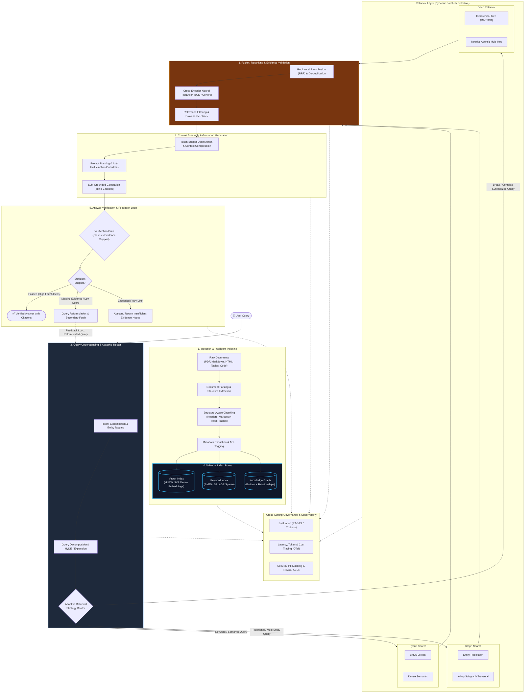
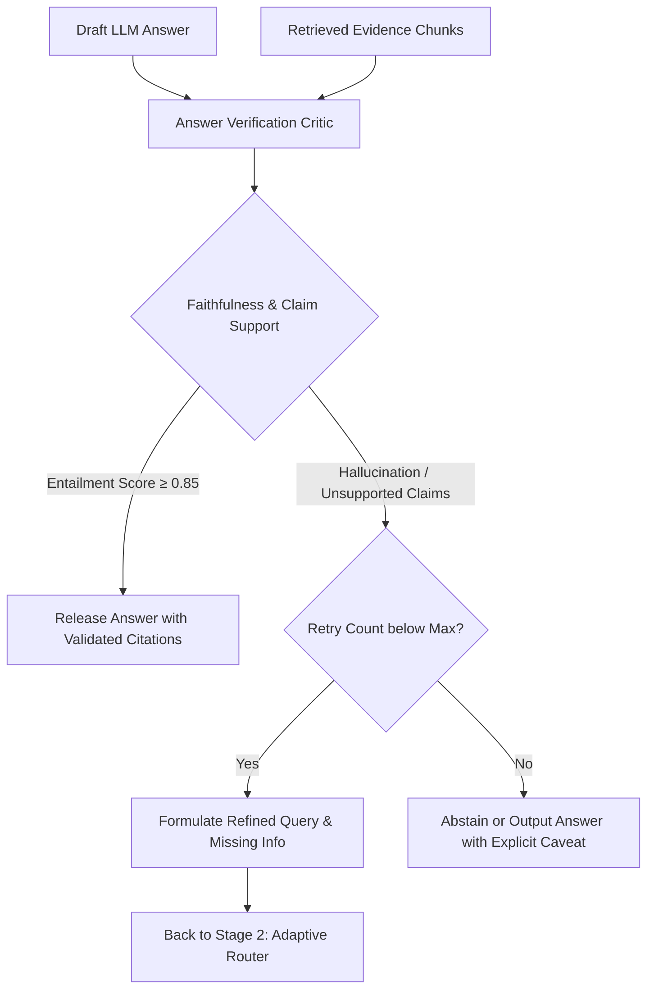
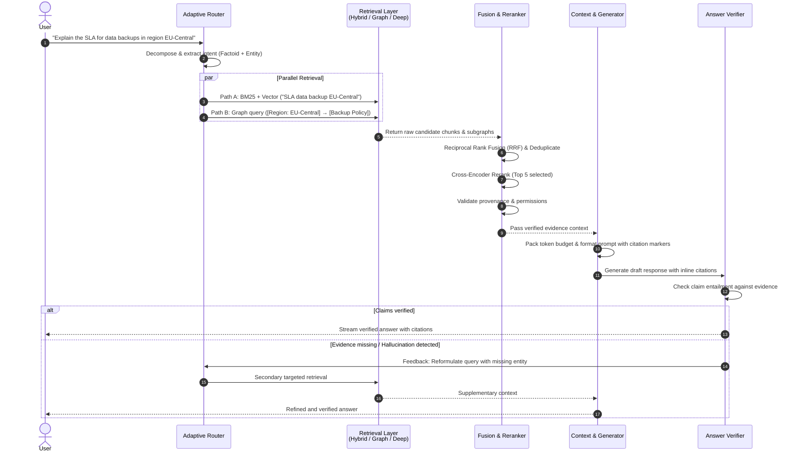
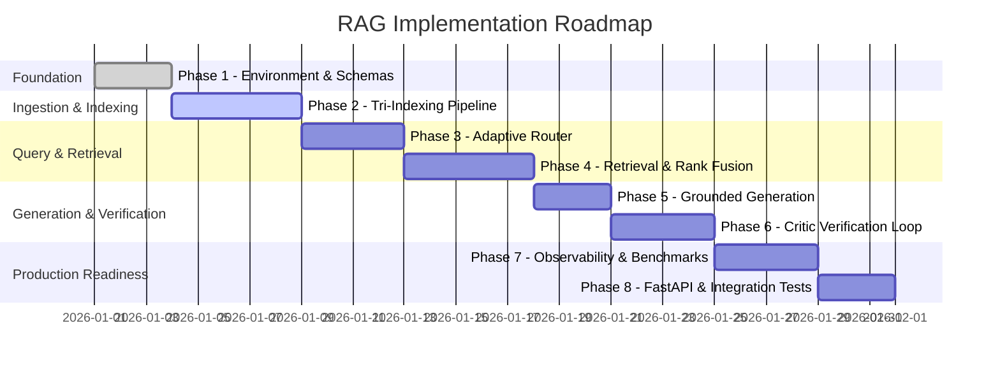

# Enterprise Agentic RAG Architecture

[](https://www.python.org/)
[](https://fastapi.tiangolo.com/)
[](docker-compose.yml)
[](.github/workflows/ci.yml)
[](#-system-architecture)

A production-grade, resilient Retrieval-Augmented Generation (RAG) system implementing intelligent indexing, adaptive multi-strategy retrieval, reciprocal rank fusion, grounded generation with inline citations, and closed-loop answer self-verification.

> **Tags / Topics:** `agentic-rag` • `rag` • `fastapi` • `llm` • `knowledge-graph` • `reranking` • `react-framework` • `information-retrieval` • `hybrid-search` • `self-verification` • `reciprocal-rank-fusion`

---

## 🏛️ System Architecture



---

## 📋 Table of Contents
1. [Core Principles](#-core-principles)
2. [Stage 1: Ingestion & Intelligent Indexing](#1-ingestion--intelligent-indexing)
3. [Stage 2: Query Understanding & Adaptive Router](#2-query-understanding--adaptive-router)
4. [Retrieval Execution Strategies](#-retrieval-execution-strategies)
5. [Stage 3: Fusion, Reranking & Evidence Validation](#3-fusion-reranking--evidence-validation)
6. [Stage 4: Context Assembly & Grounded Generation](#4-context-assembly--grounded-generation)
7. [Stage 5: Answer Verification & Feedback Loop](#5-answer-verification--feedback-loop)
8. [Cross-Cutting Concerns](#-cross-cutting-concerns)
9. [End-to-End Query Sequence Flow](#-end-to-end-query-sequence-flow)
10. [Repository Project Structure](#-repository-project-structure)
11. [Configuration & Environment](#-configuration--environment)
12. [Architectural Challenges, Disadvantages & Mitigations](#-architectural-challenges-disadvantages--mitigations)
13. [Step-by-Step Implementation Guide](#-step-by-step-implementation-guide)
14. [Real-Time Operations & CLI](#-real-time-operations--cli)
15. [Quick Reference: Pipeline Execution Lifecycle](#-quick-reference-pipeline-execution-lifecycle)


---

## 🎯 Core Principles

| Pillar | Implementation Strategy |
| :--- | :--- |
| **High Retrieval Recall** | Tri-modal retrieval: hybrid sparse-dense, knowledge graph traversal, and hierarchical multi-hop retrieval. |
| **High Precision Precision** | Multi-stage filtering using Reciprocal Rank Fusion (RRF), Cross-Encoder reranking, and provenance validation. |
| **Zero Hallucination Tolerance** | Critic-in-the-loop verification checking claim entailment before delivering responses to the user. |
| **Enterprise Security** | Document and chunk-level Access Control Lists (ACLs) enforced during retrieval. |
| **Closed-Loop Feedback** | If evidence is missing or confidence is low, the pipeline automatically reformulates the search or gracefully abstains. |

---

## 1. Ingestion & Intelligent Indexing

The ingestion layer turns unstructured and semi-structured documents into queryable, multimodal indices.

```
Raw Documents ──▶ Document Parser ──▶ Structure-Aware Chunking ──▶ Metadata & ACL Enrichment
                                                                           │
                             ┌─────────────────────────────────────────────┼─────────────────────────────────────────────┐
                             ▼                                             ▼                                             ▼
                 Vector Index (Dense)                          Keyword Index (Sparse)                        Knowledge Graph
                 - HNSW Indexing                               - BM25 Indexing                               - Entity & Relation Extraction
                 - Text Embeddings (768/1536-dim)              - Inverted Index / Tokenization               - Subgraph Triples (Node-Edge-Node)
```

### Components:
1. **Document Parsing**:
   - Extracts structured elements (Markdown headings, tables, code blocks, lists, figure captions) from PDF, Word, HTML, and Markdown files.
   - Converts tabular sections to Markdown/HTML tables to prevent spatial semantic loss.
2. **Structure-Aware Chunking**:
   - **Semantic & Header Chunking**: Breaks content along section boundaries (`#`, `##`, `###`) rather than naive character counts.
   - **Chunk Size / Overlap**: 400–800 tokens with 10–15% sliding window overlap.
   - **Parent-Child Chunking**: Small child chunks (128 tokens) optimized for vector matching linked to parent chunks (512–1024 tokens) passed to the LLM for full contextual breadth.
3. **Metadata & ACL Tagging**:
   - Fields: `doc_id`, `chunk_id`, `parent_id`, `created_at`, `source_url`, `author`, `department`, `allowed_roles`.
   - Security: Every vector and keyword record carries the access permissions of the original document.
4. **Tri-Indexing**:
   - **Vector Index**: Dense vector embeddings (e.g., `text-embedding-3-large`, `bge-large-en-v1.5`) stored in Milvus, Qdrant, or pgvector using HNSW indexing.
   - **Keyword Index**: BM25 / SPLADE stored in OpenSearch or Elasticsearch for exact keyword, acronym, and identifier lookups.
   - **Knowledge Graph**: Entity and relationship extraction (e.g., GraphRAG / Neo4j) to map relations (e.g., `[Service A] -> DEPENDS_ON -> [Database B]`).

---

## 2. Query Understanding & Adaptive Router

Users frequently ask underspecified, multi-part, or relational queries. The query understanding module prepares and routes the incoming request to the optimal retrieval strategies.

```
                          User Query: "Compare Q3 retention policies with 2024 compliance updates"
                                                      │
                                                      ▼
                                       Query Intent & Entity Extraction
                                                      │
                       ┌──────────────────────────────┴──────────────────────────────┐
                       ▼                                                             ▼
           Query Decomposition                                          Hypothetical Document (HyDE)
     Sub-Q1: "Q3 retention policies"                              Generates hypothetical answer to bridge
     Sub-Q2: "2024 compliance updates"                            vocabulary gap in vector space
                       │                                                             │
                       └──────────────────────────────┬──────────────────────────────┘
                                                      ▼
                                          Adaptive Retrieval Router
                                                      │
                        ┌─────────────────────────────┼─────────────────────────────┐
                        ▼                             ▼                             ▼
                 [Hybrid Search]               [Graph Search]               [Deep Retrieval]
```

### Key Tasks:
- **Intent Classification**:
  - `Factoid`: Single lookup -> Fast Hybrid Search.
  - `Comparative / Multi-Hop`: Multiple entities -> Graph Search + Deep Iterative Retrieval.
  - `Summary / Synthesis`: Broad corpus -> Hierarchical Tree Retrieval.
- **Query Decomposition**: Splits complex questions into independent sub-queries.
- **HyDE (Hypothetical Document Embeddings)**: Creates a synthetic target chunk using an LLM to match dense vectors in index space when query keywords are sparse.
- **Adaptive Strategy Router**: Dispatches parallel or conditional retrieval requests based on detected query characteristics.

---

## 🔍 Retrieval Execution Strategies

The system executes one or more of the following retrieval strategies concurrently:

```
┌─────────────────────────────────┐   ┌─────────────────────────────────┐   ┌─────────────────────────────────┐
│       1. Hybrid Search          │   │        2. Graph Search          │   │       3. Deep Retrieval         │
├─────────────────────────────────┤   ├─────────────────────────────────┤   ├─────────────────────────────────┤
│ • BM25 Lexical Matching         │   │ • Named Entity Recognition      │   │ • Hierarchical Summary Tree     │
│ • Dense Semantic Cosine/IP      │   │ • Knowledge Graph Traversal     │   │   (RAPTOR Clusters)             │
│ • Handles exact codes, names,   │   │ • Multi-hop relationship paths  │   │ • Iterative Multi-step Agent    │
│   and conceptual similarity     │   │ • Connects indirect context     │   │ • Follows citations recursively │
└─────────────────────────────────┘   └─────────────────────────────────┘   └─────────────────────────────────┘
```

1. **Hybrid Search (BM25 + Vectors)**:
   - Combines the precision of exact keyword matching (SKUs, IDs, API methods, errors) with semantic embedding similarity.
2. **Graph Search (Entities + Paths)**:
   - Extracts mentioned entities, queries the Knowledge Graph (Neo4j / GraphRAG), and retrieves connected subgraphs and community summaries.
3. **Deep Retrieval (Hierarchical + Iterative)**:
   - Traverses pre-computed hierarchical summary trees (e.g., RAPTOR) from high-level summaries down to granular source chunks.
   - Allows agentic retrieval loops where intermediate findings generate follow-up fetch requests.

---

## 3. Fusion, Reranking & Evidence Validation

Retrieval engines return raw candidate sets that may overlap, contain noise, or rank irrelevant documents highly. This stage standardizes, reranks, and validates the candidates.

```
Candidates from Retrieval Engines (Path A, B, C)
                      │
                      ▼
       Reciprocal Rank Fusion (RRF)
       Score(d) = Σ [ 1 / (k + rank_i(d)) ]
                      │
                      ▼
         Deduplication & Clustering
                      │
                      ▼
      Cross-Encoder Neural Reranking
      (e.g., BGE-Reranker-Large, Cohere)
                      │
                      ▼
       Evidence & Provenance Validation
       - Minimum similarity cutoff
       - Source validation & ACL verification
                      │
                      ▼
           Top-K Filtered Evidence
```

### Steps:
1. **Reciprocal Rank Fusion (RRF)**:
   - Merges disparate ranking lists with non-comparable raw scores without needing score normalization.
   - Formula:
     $$RRF\_Score(d) = \sum_{m \in M} \frac{1}{k + r_m(d)}$$
     where $k \approx 60$ and $r_m(d)$ is the rank in strategy $m$.
2. **Deduplication**: Collapses chunks sharing identical content or overlapping spans from the same document.
3. **Cross-Encoder Neural Reranking**:
   - Performs full cross-attention between `(Query, Candidate Chunk)` to compute true semantic relevance scores.
   - Retains the top $K$ (e.g., 5 to 10) high-confidence evidence chunks.
4. **Evidence & Provenance Validation**:
   - Discards chunks falling below a relevance threshold.
   - Verifies that the document source is active, non-deprecated, and accessible to the current user's role.

---

## 4. Context Assembly & Grounded Generation

Prepares the validated context for the generator LLM to prevent context fragmentation, prompt injection, and hallucinations.

```
Top-K Validated Evidence Chunks
               │
               ▼
   Token-Budget Optimization
   - Dynamic knapsack packing
   - Context compression & extractive summarization
               │
               ▼
   Context Serialization with Anchors
   [Source 1: Policy_Doc.md#sec-3] ...content...
   [Source 2: Compliance_2024.pdf#p-12] ...content...
               │
               ▼
   Grounded Prompt Template (System Constraints)
   - Strict adherence to provided sources
   - Required inline bracket citations [1], [2]
               │
               ▼
   LLM Generation (Streaming Output)
```

### Generation Safeguards:
- **Lost-in-the-Middle Mitigation**: Positions the most critical evidence chunks at the very beginning and very end of the context window.
- **Strict Grounding Instructions**:
  ```
  Answer the user prompt strictly based on the verified sources provided below.
  If the sources do not contain sufficient evidence, state clearly: "I cannot confirm this based on the available documentation."
  Always cite your sources using bracketed citations, e.g., [Doc-1#Chunk-2].
  ```
- **Token Budgeting**: Dynamically manages prompt and context tokens to reserve adequate room for output generation.

---

## 5. Answer Verification & Feedback Loop

Before the generated answer reaches the user, an automated Critic LLM inspects the output against the retrieved evidence to guarantee faithfulness.



### Verification Checks:
1. **Claim Extraction**: The critic breaks the draft answer down into atomic factual claims.
2. **NLI Entailment**: Each claim is checked against the provided context chunks using Natural Language Inference (Entailment / Neutral / Contradiction).
3. **Citation Integrity**: Verifies that citations actually point to the source text supporting the claim.
4. **Adaptive Feedback Loop**:
   - If claims lack support because the retrieval missed key info, the system generates a targeted follow-up query and repeats the retrieval cycle (up to $N=2$ retries).
   - If evidence cannot be retrieved, the system gracefully abstains rather than hallucinating.

---

## 🌐 Cross-Cutting Concerns

Cross-cutting services operate across all 5 stages of the pipeline:

```
┌──────────────────────────────────────────────────────────────────────────────────┐
│                         Cross-Cutting Operations                                 │
├─────────────────────────┬────────────────────────────┬───────────────────────────┤
│ Evaluation Benchmarks   │ Latency & Cost Monitoring  │ Security & Access Control │
├─────────────────────────┼────────────────────────────┼───────────────────────────┤
│ • RAGAS Metrics:        │ • OpenTelemetry tracing    │ • Document-level ACLs     │
│   - Context Precision   │ • Cache hit rates          │ • Role-Based Access (RBAC)│
│   - Context Recall      │ • Token consumption audits │ • PII sanitization/masking│
│   - Faithfulness        │ • Per-stage latency budgets│ • Prompt injection guards │
│   - Answer Relevance    │ • Cost attribution by team │ • Model output safety net │
└─────────────────────────┴────────────────────────────┴───────────────────────────┘
```

---

## 🔄 End-to-End Query Sequence Flow



---

## 📁 Repository Project Structure

Recommended modular implementation layout for this architecture:

```
RAG/
├── README.md                           # Architecture and system documentation
├── pyproject.toml                      # Dependencies & package metadata
├── configs/
│   ├── ingestion.yaml                  # Chunking strategies, embedding models
│   ├── retrieval.yaml                  # Vector/BM25/Graph configurations
│   ├── reranker.yaml                   # Cross-encoder thresholds & weights
│   └── evaluation.yaml                 # RAGAS / TruLens benchmark metrics
├── data/
│   ├── raw/                            # Ingestion source files
│   └── processed/                      # Extracted markdown & metadata cache
├── src/
│   ├── common/                         # Shared utilities, schemas, logger
│   │   ├── config.py
│   │   └── models.py                   # Pydantic schemas (Chunk, Query, Result)
│   ├── ingestion/                      # Stage 1: Document processing & indexing
│   │   ├── parser.py                   # Structure-aware document parsers
│   │   ├── chunker.py                  # Semantic, header & parent-child chunkers
│   │   ├── vector_indexer.py           # Dense vector index manager
│   │   ├── keyword_indexer.py          # BM25 / Sparse index manager
│   │   └── graph_indexer.py            # Entity extractor & Graph builder
│   ├── router/                         # Stage 2: Query understanding & routing
│   │   ├── intent_classifier.py        # Intent & complexity detection
│   │   ├── query_decomposer.py         # Sub-query & HyDE generator
│   │   └── adaptive_router.py          # Strategy dispatcher
│   ├── retrieval/                      # Retrieval strategies
│   │   ├── hybrid_retriever.py         # BM25 + Vector retriever
│   │   ├── graph_retriever.py          # Cypher / Graph traversal retriever
│   │   └── deep_retriever.py           # Hierarchical RAPTOR / iterative agent
│   ├── fusion/                         # Stage 3: Fusion & Reranking
│   │   ├── rrf.py                      # Reciprocal Rank Fusion implementation
│   │   ├── reranker.py                 # Cross-encoder reranker
│   │   └── validator.py                # Provenance & ACL relevance filter
│   ├── generation/                     # Stage 4: Context assembly & generation
│   │   ├── context_builder.py          # Token-budget optimizer & compressor
│   │   └── generator.py                # LLM grounded generation client
│   ├── verification/                   # Stage 5: Answer verification critic
│   │   ├── claim_extractor.py          # Atomic claim parser
│   │   ├── critic.py                   # NLI entailment & citation checker
│   │   └── feedback_loop.py            # Retry & reformulation manager
│   └── monitoring/                     # Cross-cutting observability
│       ├── tracer.py                   # OpenTelemetry / Langfuse instrumentation
│       ├── evaluator.py                # RAGAS automated evaluations
│       └── security.py                 # RBAC, ACL checks & PII masking
└── tests/                              # Unit, integration, and benchmark tests
    ├── test_ingestion.py
    ├── test_retrieval.py
    └── test_verification.py
```

---

## ⚙️ Configuration & Environment

| Variable Name | Description | Example Value |
| :--- | :--- | :--- |
| `LLM_MODEL` | Generator model identifier | `gpt-4o`, `claude-3-5-sonnet-20241022`, `gemini-1.5-pro` |
| `CRITIC_MODEL` | Verification & critique model | `gpt-4o-mini`, `claude-3-haiku` |
| `EMBEDDING_MODEL` | Dense embedding model | `text-embedding-3-large`, `BAAI/bge-large-en-v1.5` |
| `RERANKER_MODEL` | Neural cross-encoder | `BAAI/bge-reranker-large`, `rerank-v3-english` |
| `VECTOR_STORE_URI` | Vector database connection string | `http://localhost:6333` (Qdrant), `milvus:19530` |
| `GRAPH_STORE_URI` | Knowledge graph database connection | `bolt://localhost:7687` (Neo4j) |
| `OPENSEARCH_URI` | Sparse / BM25 search engine URI | `https://localhost:9200` |
| `RRF_K` | Smoothing constant for rank fusion | `60` |
| `MAX_VERIFICATION_RETRIES` | Max query reformulation attempts | `2` |
| `FAITHFULNESS_THRESHOLD` | Minimum entailment score to pass | `0.85` |

---

## ⚠️ Architectural Challenges, Disadvantages & Mitigations

While an advanced, multi-strategy agentic RAG system achieves high recall and grounded precision, it introduces architectural overheads, latency bottlenecks, and operational vulnerabilities. Below is the systematic breakdown of failure modes and their production mitigations:

### 📊 Summary Trade-Off & Mitigation Matrix

| # | Disadvantage / Risk | Impact Level | Root Cause | Engineering Mitigation |
| :-: | :--- | :---: | :--- | :--- |
| **1** | **High Latency** | 🔴 High | Sequential execution of routing, multiple retrievers, cross-encoders, and critic verification LLM. | Async/parallel retrieval execution, strict timeout budgets, speculative early-exit, selective verification. |
| **2** | **High Computational Cost** | 🔴 High | Multiple embedding models, cross-encoders, LLM routing calls, and Graph extraction workloads. | Fast SLM for routing, semantic caching, shortlisting before reranking, on-demand/lazy graph indexing. |
| **3** | **Routing Failures** | 🟡 Medium | Semantic router misclassifies intent (e.g., using heavy graph for simple facts, or keyword for relational questions). | Hybrid-retrieval safety fallback, confidence score thresholding, regression query test suites. |
| **4** | **Knowledge Graph Errors** | 🔴 High | LLM-based entity-relation extraction introduces hallucinated edges, missed entities, or entity aliasing. | Provenance tracking on graph edges, confidence scoring, schema validation, treating graph as auxiliary hint. |
| **5** | **Reranker Discards Evidence** | 🟡 Medium | Cross-encoder evaluates isolated chunks without wider context, penalizing distributed multi-hop evidence. | Hierarchical parent-child expansion, reciprocal rank fusion (RRF), context window stitching, recall benchmarks. |
| **6** | **Uncontrolled Retrieval Loops** | 🔴 High | The feedback critic repeatedly requests follow-up searches, burning tokens and causing non-deterministic timeouts. | Hard iteration caps ($N \le 2$), overall request timeout, incremental stopping criteria, token budget enforcement. |
| **7** | **Difficult Multi-Component Evaluation** | 🟡 Medium | End-to-end evaluation hides individual component bottlenecks (routing vs. retrieval vs. rerank vs. generation). | Component-isolated benchmarking (RAGAS/TruLens), per-stage golden test sets, baseline ablation testing. |
| **8** | **Verification is Not a Guarantee** | 🔴 High | Critic LLM can miss subtle hallucinations or approve plausible-sounding answers with superficial citations. | Atomic claim decomposition, strict NLI entailment check, exact quote citation matching, graceful abstention. |

---

### Detailed Failure Mode Analysis & Solutions

#### 1. High Latency (High Impact)
* **The Problem**: Executing query routing, multiple retrieval strategies (Hybrid + Graph + Deep), cross-encoder reranking, context formatting, LLM generation, and self-verification sequentially creates cumulative latency ($>4–8$ seconds), degrading real-time UX.
* **Production Mitigations**:
  - **Concurrent Asynchronous Retrieval**: Fire Hybrid (BM25 + Vector) and Graph queries in parallel using `asyncio.gather` with strict per-path timeouts (e.g., 250ms).
  - **Selective / Gated Verification**: Run the verification critic only for high-risk domains, low reranking confidence scores, or external/public user queries. For routine queries with $>0.90$ reranker confidence, stream output directly.
  - **Speculative Streaming**: Begin streaming the LLM token stream with a brief UI latency buffer while verification runs asynchronously on the first sentence/claim.

#### 2. High Computational Cost
* **The Problem**: Multiple LLM invocations per user turn (Query Decomposer + Graph Traversal + Answer Generator + Verification Critic), paired with heavy GPU-bound cross-encoder rerankers, dramatically inflate infrastructure expenses.
* **Production Mitigations**:
  - **Small Language Models (SLMs) for Intermediary Steps**: Utilize lightweight, quantized models (e.g., `gpt-4o-mini`, `gemini-1.5-flash`, or local `Llama-3-8B`) for routing, query expansion, and claim verification.
  - **Tiered Semantic Caching**: Cache exact and high-similarity vector queries (Redis / GPTCache) to bypass the pipeline entirely for frequent queries.
  - **Bounded Reranking Shortlist**: Only pass the top $M=20$ candidates to the cross-encoder reranker rather than hundreds of raw retrieved chunks.
  - **Selective Graph Construction**: Limit GraphRAG indexing to core relational entities and domains rather than extracting full entity graphs across the entire document corpus.

#### 3. Routing Failures
* **The Problem**: An imperfect query classifier may misroute a simple lookup to an expensive, high-latency graph traversal, or route a multi-entity relational inquiry to a pure keyword search, resulting in empty or low-relevance context.
* **Production Mitigations**:
  - **Fail-Safe Hybrid Foundation**: Always include baseline Hybrid Search (BM25 + Dense Vector) as a default floor; activate Graph and Deep paths as additive enrichments rather than mutually exclusive silos when classification confidence is borderline.
  - **Confidence Threshold Routing**: If the router’s confidence in a specialized strategy is below $0.75$, dispatch a blended retrieval fan-out.
  - **Continuous Router Benchmarks**: Curate an automated evaluation suite of labeled query categories to regression-test routing accuracy continuously in CI/CD.

#### 4. Knowledge Graph Errors & Hallucinated Relations
* **The Problem**: Automated entity and relationship extraction can merge distinct entities with similar names (aliasing), extract erroneous triples, or miss implicit connections. A corrupted graph then amplifies false evidence into the generator.
* **Production Mitigations**:
  - **Edge Provenance & Lineage**: Every edge in the Knowledge Graph must retain a direct reference (`chunk_id`, document link, character offset, and extraction confidence score) to its source text.
  - **Entity Disambiguation & Canonicalization**: Implement fuzzy deduplication, Wikidata/custom ontology mapping, and entity clustering before committing triples to the database.
  - **Auxiliary Graph Role**: Treat graph connections as discovery guidance to pull source text chunks rather than accepting graph triples as standalone ground truth.

#### 5. Reranking Can Discard Useful Evidence
* **The Problem**: Cross-encoders evaluate chunks in isolation. If an answer requires multi-hop synthesis across three separate sections, an individual intermediate chunk may appear irrelevant in isolation and get filtered out before reaching the generator.
* **Production Mitigations**:
  - **Parent-Child & Section Expansion**: When a child chunk passes the reranker, automatically pull its parent container or adjacent chunks into the context window to preserve global context.
  - **Score-Preserving Fusion**: Combine Cross-Encoder relevance scores with reciprocal rank positions rather than relying on a hard cross-encoder cutoff.
  - **A/B Recall Monitoring**: Track `Recall@K` before and after reranking against curated multi-hop benchmark datasets.

#### 6. Uncontrolled Retrieval Loops & Token Waste
* **The Problem**: If an answer fails the verification check, the agent might re-query indefinitely, consuming extensive tokens, spiking latency, and potentially returning inconsistent or contradictory answers across iterations.
* **Production Mitigations**:
  - **Hard Iteration Cap**: Impose a strict maximum retry limit:
    ```python
    MAX_RETRIES = 2
    if current_turn >= MAX_RETRIES:
        return graceful_abstain("Evidence verified is insufficient to guarantee an accurate response.")
    ```
  - **Token & Time Budgeting**: Set a hard global execution deadline (e.g., 5.0 seconds total); if the budget is exhausted during a retry, return the best grounded partial answer with an explicit confidence caveat.
  - **Delta-Query Enforcement**: Require the reformulation module to produce a distinct semantic query focus that targets specific identified missing claims rather than re-running broad queries.

#### 7. Difficult Multi-Component Evaluation
* **The Problem**: When the final answer is inaccurate, diagnosing whether the failure stemmed from chunking, indexing, routing, keyword search, vector distance, reranker filtering, prompt instructions, or verification is challenging.
* **Production Mitigations**:
  - **Decoupled Metric Instrumentation**:
    - *Retrieval Quality*: Hit Rate, MRR (Mean Reciprocal Rank), Context Recall.
    - *Reranking Quality*: NDCG@10, Precision@K.
    - *Generation Quality*: Faithfulness, Answer Relevance, Semantic Similarity to Ground Truth.
    - *Verification Accuracy*: True Positive / False Positive rates on synthetic hallucination tests.
  - **Isolated Golden Datasets**: Evaluate each subsystem in isolation against ground-truth benchmarks before testing end-to-end.
  - **Baseline Comparison**: Regularly benchmark the multi-stage system against a naive single-vector RAG baseline to verify that architectural complexity yields measurable accuracy gains.

#### 8. Verification is Not a Guarantee
* **The Problem**: A secondary verification model can suffer from the same cognitive blind spots or biases as the generator LLM. It may approve an answer with valid-looking citation markers `[1]` even if the cited document does not strictly entail the claim.
* **Production Mitigations**:
  - **Exact Span Grounding**: Require verification algorithms to match claims to exact character/sentence spans within the cited chunk.
  - **Model Diversity**: Use a distinct model family or architecture for verification (e.g., an NLI-specialized classifier like DeBERTa-v3 or a different LLM provider) rather than re-using the same generator model.
  - **Explicit Abstention Protocol**: Calibrate the system prompt and verifier to prioritize "I do not have sufficient information in the provided records" over speculative extrapolation.

---

## 🛠️ Step-by-Step Implementation Guide

Follow this phased engineering roadmap to build, test, and deploy this architecture systematically.



---

### Phase 1: Environment & Foundational Setup

#### Step 1.1: Initialize Project & Virtual Environment
The repository already pins its stack; install exactly that instead of an
alternate one, so local results match CI and the container image.
```bash
python -m venv .venv
source .venv/bin/activate  # Windows: .venv\Scripts\activate

pip install -r requirements-dev.txt   # runtime + test dependencies, pinned
cp .env.example .env                  # then fill in API_KEYS and any LLM key
```

#### Step 1.2: Run the Service
The vector, BM25 and graph indexes are in-process, so no external datastore is
required for local development.
```bash
python -m pytest -q          # hermetic: no keys, no network
python main.py serve         # http://localhost:8000
# or: docker compose up --build
```

> The phases below describe the full design and an optional evolution toward
> external stores (Qdrant / OpenSearch / Neo4j). None of those adapters are
> wired into `src/` today — do not follow the original infra steps expecting
> them to affect runtime behaviour.

#### Step 1.3: Define Core Data Schemas (`src/common/models.py`)
Establish strict Pydantic schemas shared across all pipeline components:
```python
from pydantic import BaseModel, Field
from typing import List, Dict, Optional, Any

class Chunk(BaseModel):
    chunk_id: str
    doc_id: str
    parent_id: Optional[str] = None
    text: str
    metadata: Dict[str, Any] = Field(default_factory=dict)
    allowed_roles: List[str] = Field(default_factory=lambda: ["public"])

class RetrievalCandidate(BaseModel):
    chunk: Chunk
    source_strategy: str  # 'hybrid', 'graph', 'deep'
    score: float
    rank: int = 0

class VerifiedResponse(BaseModel):
    answer: str
    citations: List[str]
    faithfulness_score: float
    verification_passed: bool
    retries_used: int
    fallback_used: bool = False
```

---

### Phase 2: Ingestion & Intelligent Tri-Indexing (Stage 1)

#### Step 2.1: Document Parsing & Structure Extraction (`src/ingestion/parser.py`)
- Ingest PDFs, Markdown, HTML, and Word documents using structure-aware parsers (e.g., `Unstructured`, `pymupdf4llm`).
- Preserve table hierarchies in Markdown/HTML formats to retain column-row relationships.

#### Step 2.2: Implement Hierarchical Parent-Child Chunking (`src/ingestion/chunker.py`)
- Split documents into **Parent Chunks** (~512-1024 tokens) representing full logical subsections.
- Subdivide each parent into **Child Chunks** (~128 tokens) for fine-grained semantic embedding match.
- Store parent references in child chunk metadata (`parent_id`).

#### Step 2.3: Build Tri-Index Sinks
1. **Dense Vector Index** (`src/ingestion/vector_indexer.py`):
   - Generate embeddings using `text-embedding-3-large` or `BAAI/bge-large-en-v1.5`.
   - Upsert vectors into Qdrant/Milvus collections configured with `HNSW` (Cosine metric).
2. **Sparse Keyword Index** (`src/ingestion/keyword_indexer.py`):
   - Index child chunks into OpenSearch with BM25 analyzer, keeping stemmed and keyword tokens.
3. **Knowledge Graph Indexer** (`src/ingestion/graph_indexer.py`):
   - Use an extraction prompt with an LLM to identify `(Subject, Predicate, Object)` triples.
   - Upsert nodes and relationships into Neo4j via Cypher:
     ```cypher
     MERGE (s:Entity {name: $sub, type: $sub_type})
     MERGE (o:Entity {name: $obj, type: $obj_type})
     MERGE (s)-[r:RELATION {type: $rel, chunk_id: $chunk_id}]->(o)
     ```

---

### Phase 3: Query Understanding & Adaptive Routing (Stage 2)

#### Step 3.1: Query Intent Classifier (`src/router/intent_classifier.py`)
Use a fast Small Language Model (SLM) with structured output to analyze user intent:
```python
from pydantic import BaseModel
from typing import Literal

class QueryIntent(BaseModel):
    intent: Literal["factoid", "relational", "synthesized_summary"]
    sub_queries: List[str]
    entities: List[str]
    needs_graph: bool
    needs_deep: bool
    confidence: float
```

#### Step 3.2: Query Decomposition & HyDE Generator (`src/router/query_decomposer.py`)
- For multi-entity or comparative questions, split the query into 2–3 independent sub-questions.
- Generate a 1-paragraph Hypothetical Document Embedding (HyDE) to bridge lexical vocabulary gaps for dense vector search.

#### Step 3.3: Adaptive Dispatcher (`src/router/adaptive_router.py`)
- Route based on classified intent:
  - Simple factoids -> Hybrid Search (BM25 + Vectors).
  - High entity count / relational -> Hybrid Search + Graph Traversal.
  - Broad overview / synthesis -> Deep Hierarchical Retrieval (RAPTOR tree).
- **Fail-safe Rule**: If routing confidence $< 0.75$, fall back to Hybrid Search with additive branches.

---

### Phase 4: Tri-Modal Retrieval & Reciprocal Rank Fusion (Stage 3)

#### Step 4.1: Parallel Asynchronous Retrievers (`src/retrieval/`)
Execute enabled retrieval paths concurrently using `asyncio.gather` with strict timeouts:
```python
async def execute_retrieval(query: str, intent: QueryIntent) -> List[RetrievalCandidate]:
    tasks = [hybrid_retriever.search(query)]
    if intent.needs_graph:
        tasks.append(graph_retriever.search(intent.entities))
    if intent.needs_deep:
        tasks.append(deep_retriever.search(query))
    
    # Bound retrieval time to 350ms
    results = await asyncio.gather(*tasks, return_exceptions=True)
    return flatten_and_filter(results)
```

#### Step 4.2: Reciprocal Rank Fusion (RRF) (`src/fusion/rrf.py`)
Merge ranked lists from different search algorithms without normalizing incompatible scores:
```python
def reciprocal_rank_fusion(
    ranked_lists: List[List[RetrievalCandidate]], 
    k: int = 60
) -> List[RetrievalCandidate]:
    rrf_scores = {}
    for candidate_list in ranked_lists:
        for rank, candidate in enumerate(candidate_list):
            chunk_id = candidate.chunk.chunk_id
            if chunk_id not in rrf_scores:
                rrf_scores[chunk_id] = {"candidate": candidate, "score": 0.0}
            rrf_scores[chunk_id]["score"] += 1.0 / (k + rank + 1)
            
    sorted_candidates = sorted(
        rrf_scores.values(), 
        key=lambda x: x["score"], 
        reverse=True
    )
    return [item["candidate"] for item in sorted_candidates]
```

#### Step 4.3: Cross-Encoder Neural Reranker (`src/fusion/reranker.py`)
- Feed the top $M=20$ candidates through a Cross-Encoder (e.g., `BAAI/bge-reranker-large` or Cohere Rerank API).
- Take the top $K=5$ chunks and expand them to their **Parent Chunk** container to preserve context before passing to generation.

---

### Phase 5: Grounded Generation (Stage 4)

#### Step 5.1: Token Budgeting & Lost-in-the-Middle Layout (`src/generation/context_builder.py`)
- Enforce strict token budget (e.g., max 3,000 tokens for evidence).
- Sort chunks to place highest-confidence evidence at the beginning and the end of the context window.
- Tag each chunk with anchor IDs: `[Doc-ID#Chunk-Index]`.

#### Step 5.2: Generation Prompt Template (`src/generation/generator.py`)
```markdown
You are a verified enterprise assistant. Answer the user prompt using ONLY the evidence chunks below.

RULES:
1. Every factual statement must cite its supporting source using bracket tags, e.g. [Doc-1#C-3].
2. If evidence is contradictory or incomplete, explain what is missing.
3. Do NOT extrapolate or introduce external facts.

EVIDENCE CHUNKS:
{formatted_context}

USER QUESTION:
{query}
```

---

### Phase 6: Answer Verification Critic & Closed Feedback Loop (Stage 5)

#### Step 6.1: Claim Decomposition & Verification Critic (`src/verification/critic.py`)
- Parse the generated answer into discrete atomic claims:
  `["Backup runs daily at 02:00 UTC", "Retention is 30 days"]`
- For each claim, evaluate entailment against the cited evidence chunks:
  - `Entails (1.0)`: Evidence strictly supports the claim.
  - `Neutral (0.0)`: Evidence mentions the topic but does not prove the claim.
  - `Contradicts (-1.0)`: Evidence opposes the claim.

#### Step 6.2: Feedback Loop Orchestrator (`src/verification/feedback_loop.py`)
```python
MAX_RETRIES = 2

async def run_rag_loop(user_query: str) -> VerifiedResponse:
    current_query = user_query
    for attempt in range(MAX_RETRIES + 1):
        candidates = await execute_retrieval(current_query)
        reranked = rerank_and_expand(candidates)
        draft_answer = await generate_answer(user_query, reranked)
        
        verification = await verify_claims(draft_answer, reranked)
        if verification.faithfulness_score >= 0.85:
            return VerifiedResponse(
                answer=draft_answer,
                citations=verification.valid_citations,
                faithfulness_score=verification.faithfulness_score,
                retries_used=attempt
            )
        
        if attempt < MAX_RETRIES:
            current_query = reformulate_query(user_query, verification.missing_claims)
            
    return VerifiedResponse(
        answer="I cannot verify a complete answer with the available evidence.",
        citations=[],
        faithfulness_score=0.0,
        retries_used=MAX_RETRIES,
        fallback_used=True
    )
```

---

### Phase 7: Observability, Security & Benchmarking

#### Step 7.1: OpenTelemetry & Tracing (`src/monitoring/tracer.py`)
- Instrument each pipeline phase with span attributes:
  - `router.intent`, `retrieval.candidates_count`, `rerank.latency_ms`, `llm.prompt_tokens`, `verification.faithfulness`.
- Connect to Langfuse or Arize Phoenix for visual trace inspection.

#### Step 7.2: Automated RAGAS CI/CD Evaluation (`src/monitoring/evaluator.py`)
Run automated regression benchmarks against a golden dataset of 50+ question-answer-ground-truth pairs:
```python
from ragas import evaluate
from ragas.metrics import faithfulness, answer_relevancy, context_precision, context_recall

results = evaluate(
    dataset=eval_dataset,
    metrics=[faithfulness, answer_relevancy, context_precision, context_recall]
)
print(results)
```

---

### Phase 8: API Layer & End-to-End Orchestration

#### Step 8.1: FastAPI Endpoints (`src/api/server.py`)
Expose production REST & SSE streaming endpoints:
- `POST /api/v1/ingest`: Upload and ingest new document packages.
- `POST /api/v1/query`: Execute synchronous or SSE streaming RAG query.
- `GET /health`: Readiness & database connectivity checks (Qdrant, Neo4j, OpenSearch).

#### Step 8.2: Validation Checklist Before Production
- [ ] Retrieval latency under 400ms (P95).
- [ ] Faithfulness score $> 0.90$ across golden test dataset.
- [ ] Hard timeout enforced on parallel retrievers.
- [ ] Document ACL security tags verified on all retrieval queries.
- [ ] Abstention protocol activates reliably when zero evidence is retrieved.

---

## ⚡ Real-Time Operations & Agentic RAG CLI

The system provides an autonomous Agentic RAG engine powered by **Groq** (`llama-3.3-70b-versatile`) and native function calling, with offline deterministic fallback, live thought streaming, and persistent storage in `data/storage/`.

### 🔑 Groq API Key Configuration

To enable ultra-fast inference and native tool calling with Groq:
1. Obtain an API key from [Groq Console](https://console.groq.com/keys).
2. Set the key in `.env` or in your terminal session:

**In `.env`:**
```ini
GROQ_API_KEY=gsk_your_groq_api_key_here
GROQ_MODEL=llama-3.3-70b-versatile
GROQ_FAST_MODEL=llama-3.1-8b-instant
```

**In PowerShell:**
```powershell
$env:GROQ_API_KEY = "gsk_your_groq_api_key_here"
```

**In Bash/Linux:**
```bash
export GROQ_API_KEY="gsk_your_groq_api_key_here"
```

> **Note**: If `GROQ_API_KEY` is not set, the system automatically falls back to the built-in deterministic local engine without requiring any external internet connectivity or API credits.

---

### 1. Ingest Real Documents in Real Time
Ingest individual PDF, Markdown, or plain text files, or scan entire directories:
```bash
# Ingest a single PDF, Markdown or text file
python main.py ingest /path/to/document.pdf

# Ingest an entire directory with custom access control roles
python main.py ingest ./data/policies --roles employee,engineer
```

### 2. Autonomous Agentic Query Execution
Execute queries with full multi-step ReAct planning, live tool calling, and observation telemetry:
```bash
python main.py query "What encryption standard is mandated for customer data?"
```

Sample CLI output:
```text
🧠 Agent Engine: [GROQ : llama-3.3-70b-versatile]
🔎 Query: 'What encryption standard is mandated for customer data?'

📋 [Agent Plan: 2 Sub-goals]
   1. Search hybrid knowledge store for encryption standard policy text
   2. Verify parent context and customer data requirements

  🤔 Thought (Step 1): Need to retrieve the encryption policy for customer data.
  ⚙️ Action: calling tool `search_hybrid`({'query': 'customer data encryption standard', 'top_k': 3})
  📥 Observation [✓ Relevant]: {'passages': [{'text': 'AES-256 is required at rest...', 'citation_tag': '[pol_1#chunk_2]'}]}

   Status: ✅ VERIFIED
   Faithfulness: 1.00 | Latency: 240.5ms | Retries: 0
   Citations: [pol_1#chunk_2]

💬 Answer:
All customer data must be encrypted at rest using AES-256 [pol_1#chunk_2].
```

### 3. Interactive Real-Time Chat (Live REPL)
Start a live interactive session with the ReAct agent:
```bash
python main.py chat --roles employee
```

### 4. Check Persistent Index & Graph Status
Inspect indexed parent chunks, child vectors, and Knowledge Graph nodes/edges:
```bash
python main.py status
```

### 5. Launch the FastAPI Server
```bash
# Development (anonymous dev roles are granted when no keys are configured)
python main.py serve --port 8000

# Production: authentication is mandatory and startup fails without keys
export APP_ENV=production
export API_KEYS="live-key-1:admin,engineer|live-key-2:public"
python main.py serve --port 8000
```

All data endpoints require the `X-API-Key` header; the key's roles are resolved
server-side, so a caller can never widen its own access by sending roles.

| Method | Endpoint | Auth | Purpose |
| --- | --- | --- | --- |
| `GET` | `/health` | public | Liveness probe (no index access) |
| `GET` | `/ready` | public | Readiness probe with index counts |
| `GET` | `/metrics` | admin | Prometheus exposition |
| `POST` | `/api/v1/ingest` | write role | JSON document ingestion |
| `POST` | `/api/v1/ingest/file` | write role | Multipart upload (extension + size validated) |
| `GET` | `/api/v1/documents` | any role | Document library, filtered by the caller's roles |
| `DELETE` | `/api/v1/documents/{doc_id}` | write role | Remove a document and its chunks |
| `POST` | `/api/v1/query` | any role | Verified RAG query |
| `POST` | `/api/v1/agent/query` | any role | Agent answer with full trajectory |
| `POST` | `/api/v1/agent/stream` | any role | SSE stream of thoughts, actions, answer |
| `GET` | `/api/v1/agent/info` | any role | Provider, tools, index stats |
| `GET` | `/api/v1/graph` | any role | Knowledge graph overview |
| `GET` | `/api/v1/chunk/{tag}` | any role | Evidence for a citation (role-checked) |
| `GET` | `/api/v1/admin/usage` | admin | Token and cost accounting |
| `GET` | `/api/v1/admin/audit` | admin | Recent ingest/query audit events |

Errors share one shape, so clients branch on `error.code` instead of parsing prose:

```json
{"error": {"code": "unauthorized", "message": "Missing X-API-Key header."}, "request_id": "71dbee3e61984d13"}
```

An answer carries two independent verdicts, and clients should render them
differently — they mean different things:

| Field | Meaning |
| --- | --- |
| `verification_passed: true` | Every claim in `answer` maps to a retrieved passage. |
| `verification_passed: false`, `abstained: false` | An answer was produced but some sentences are ungrounded; they are listed in `unsupported_claims`. |
| `abstained: true` | The system declined to answer: no retrieved passage supported the question. `citations` and `unsupported_claims` are empty and `faithfulness_score` is `0.0`, because a refusal asserts nothing to score. When a passage did share the query's terms, the answer names it so the user can inspect it. |

### 6. Container Deployment
```bash
docker build -t enterprise-rag .
docker run -p 8000:8000 \
  -e APP_ENV=production \
  -e API_KEYS="live-key-1:admin,engineer|live-key-2:public" \
  -v rag_data:/data \
  enterprise-rag
```
> The index, its lock and the rate limiter are per-process, so the image runs a
> single worker. Set `ALLOW_MULTI_WORKER=true` only after moving the index to a
> shared store.

### 7. Testing
```bash
pip install -r requirements-dev.txt
python -m pytest -q
```
The suite is hermetic — no LLM keys, no network, no shared storage:

- `tests/test_api.py` — API contracts: auth, RBAC, error shapes, upload
  validation, path-traversal handling, access control on evidence.
- `tests/test_infrastructure.py` — metrics rendering, rate limiter, filename
  sanitising, provider retry/failover, atomic persistence and ingestion locking.
- `tests/test_golden_set.py` — retrieval quality gate over
  `tests/golden/retrieval_golden.json` (recall floor plus ACL leak assertions).
- `tests/test_agentic_rag.py`, `test_pipeline_e2e.py`, `test_retrieval.py`,
  `test_verification.py`, `test_ingestion.py` — component and end-to-end behaviour.

---

## 🚀 Quick Reference: Agentic RAG Execution Lifecycle

1. **Plan & Decompose**: Multi-hop query is decomposed into targeted sub-goals by the planner.
2. **ReAct Reasoning Loop**:
   - **Thought**: Agent reasons about which tool to invoke.
   - **Action**: Tool execution (`search_hybrid`, `query_knowledge_graph`, `read_parent_context`, `compare_entities`).
   - **Observation**: Output returned and graded for relevance (CRAG).
3. **Self-Correction & Refinement**: If evidence is low quality or missing, the agent reformulates queries or traverses graph hops.
4. **Self-RAG Grounding**: Answer synthesized with strict inline citation tags (`[doc#chunk]`) and evaluated by `HallucinationGrader`.
5. **PII Masking & Delivery**: Final response is sanitized and returned with full telemetry.


